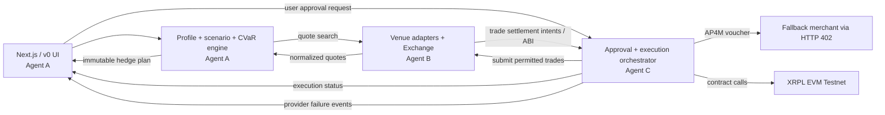

# Switchboard — Architecture & integration states

## Agent ownership; zero overlapping writable directories
- **A:** `apps/web/**`, `services/strategy/**`; `docs/V0_UI_HANDOFF.md` once v0 is exported.
- **B:** `services/markets/**`, `contracts/solidity/**` (new), `contracts/abi/**` (generated by B); own venue credential adapters and exchange smart contracts.
- **C:** `services/execution/**`, `infra/**`; AP4M, Ledger, XRPL EVM tx orchestration, service health monitors and failover.
- **Frozen shared:** `contracts/openapi.yaml`, `packages/contracts/**`, `fixtures/**`. Changes require integrator-review PR with regenerated types and fixtures. Each agent MAY add adapter-private types under its owned directory.

## Network/process assumptions
- Local `A` at `http://localhost:4101`; `B` at `http://localhost:4102`; `C` at `http://localhost:4103`; web `http://localhost:3000`. Ports are recommendations.
- Authorization: external user session through web BFF; service-to-service bearer token or mTLS; signed approvals and webhook callbacks.
- Postgres: separate schema per service or separate databases; no cross-service SQL writes. Redis for cache; queue for durable background retries. Outbox publication after DB transaction.
- Each API has `GET /healthz`, `GET /readyz`, version, capability and data freshness status.
- Central `X-Correlation-ID`, `X-Request-ID`; `Idempotency-Key` on POSTs; retry with exponential backoff and dedupe.

## Golden flow
1. `POST /v1/companies/analyze` (A) → company + risk exposures + assumptions.
2. `POST /v1/markets/search` (B) → candidate instruments, quotes, fee/depth and exact eligibility; also provider capacity alternatives.
3. `POST /v1/strategies/generate` (A) → versioned plan, 95%-CVaR improvement, no-action comparator, warnings.
4. `POST /v1/execution/approvals` (C) → pending approval request with deterministic plan hash.
5. Explicit approval & permitted authorization (C) → `APPROVED` with signer proof. Scope contains per-leg limits and AP4M budget.
6. `POST /v1/execution/runs` (C) → C verifies quote, funding, expiry, idempotency; calls B's `POST /v1/markets/orders` or on-chain sandbox exchange via contract ABI.
7. C monitors events and service health. Upon triggering failover, C performs AP4M HTTP 402 purchase within PREAPPROVED channel allowance, verifies RLUSD settlement, switches traffic and records outcome.
8. UI polls/subscribes C execution status; show exchange/merchant tx hashes and approval log.

## State machines
**Hedge plan:** `DRAFT → QUOTED → PENDING_APPROVAL → APPROVED → EXECUTING → ACTIVE`; exceptional `EXPIRED|REAPPROVAL_REQUIRED|REJECTED|PARTIALLY_EXECUTED|FAILED`.

**Market order:** `CREATED → ACCEPTED → PARTIALLY_FILLED → FILLED`; other terminals `REJECTED|CANCELLED|EXPIRED`. Audit partial fills; no silent retries of live orders.

**Failover:** `HEALTHY → SUSPECT → VERIFIED_FAILURE → SEARCHING_FALLBACK → QUOTED_402 → VOUCHER_SIGNED → VOUCHER_REDEEMED → RLUSD_SETTLED → FALLBACK_ACTIVE`; else `BUDGET_BLOCKED|UNAVAILABLE|UNVERIFIED|FAIL_CLOSED`. Voucher redemption and RLUSD transfer are separate verifications.

**RFQ:** `CREATED → QUOTING → FIRM_QUOTE → ACCEPT_PENDING_COLLATERAL → ACCEPTED → OPEN → SETTLED`; also `EXPIRED|WITHDRAWN|DISPUTED|REJECTED`.

## Latency and eventual consistency
- No synchronous promise of atomic external-venue and XRPL EVM settlement. Each leg is a distinct saga step with its own receipts, retry semantics and compensation path.
- Market quote and API service-health freshness are separate; 30s price TTL default for sandbox, configurable by venue; execution must revalidate.
- Do not issue a second payment voucher because UI polling timed out. Persist idempotency key linked to merchant channel and sequence.

## Settlement and collateral design
- Orderbook matching off-chain is not equivalent to on-chain settlement. EVM escrow contracts must check collateral sufficiency, signed order/nonce validity, cancellation and expiration, total outstanding max-payout liability, oracle result and settlement window.
- Use full worst-case collateralization for binary and capped contracts. If loss isn't bounded, **do not list** the contract until a robust margin/clearing model exists.
- Market-operator ability to alter oracles and pause/recover is constrained, disclosed and multisig-controlled. Unit tests include replay, double claims, adversarial oracle, time-bound disputes, and withdrawing funds backing open positions.
- Service capacity commitments are operational obligations; collateral alone doesn't prove capacity. Support proof-of-reservation and periodic challenge load test.

## Operational data and event envelope
All services emit/consume events with:
`{eventId, kind, schemaVersion, aggregateId, occurredAt, correlationId, producer, causationId, payload}`.
Core events: `company.exposures_confirmed`, `market.quote_updated`, `strategy.plan_created`, `approval.granted`, `execution.order_submitted`, `execution.order_filled`, `service.primary_failed`, `ap4m.payment_initiated`, `ap4m.voucher_redeemed`, `ap4m.settlement_confirmed`, `service.fallback_activated`, `exchange.contract_resolved`.

## Specific security and venue boundaries
- There are FOUR separate concepts: (1) platform approval for a plan; (2) venue account permission to place an order; (3) hardware signing if supported for an on-chain obligation; (4) autonomous AP4M payments preauthorized from a separately funded wallet. These must not be collapsed into one flag.
- `polymarket_international` always `reference_only` for US operations; do not execute or route around restrictions. `polymarket_us` access depends on separate eligible account and API credentials.
- `ledger_agent_intent` supports ETH/SOL use cases per current docs, not XRPL EVM direct; label unsupported for EVM, evaluate DMK/ETH signing capability separately without assuming clear signing for every chain.
- Mastercard AP4M kit is hackathon-only; do not market as general production SDK.

## Fault-injection tests
- Market quote is stale before approval → `REAPPROVAL_REQUIRED`.
- Venue has no account credentials/US blocked → read-only venue cannot execute.
- RFQ expires mid-accept → cannot fill.
- Insufficient collateral → contract order rejected.
- Repeated idempotency key → returns same run, no duplicate funds movement.
- Primary endpoint returns 500 repeatedly but health quorum insufficient → cannot settle outage derivative.
- Primary unavailable; backup quality benchmark fails → reject substitute and use next candidate.
- Merchant receives 402; payment voucher redeemed but RLUSD not yet transferred → `VOUCHER_REDEEMED` pending, not `RLUSD_SETTLED`.
- AP4M daily cap reached → no new voucher; halt failover with visible failure reason.
